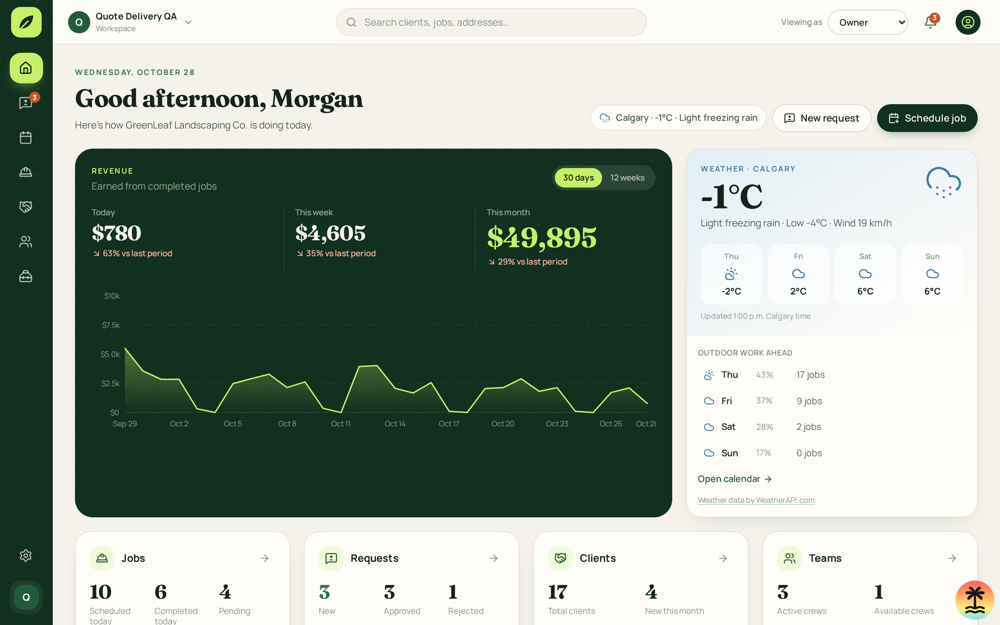

# Dashboard weather

See the [design record conventions](../design/README.md).

| Screen    | Route        | Shows                                                                                           |
| --------- | ------------ | ----------------------------------------------------------------------------------------------- |
| Dashboard | `/dashboard` | Current Calgary weather and available daily forecast alongside workspace metrics or worker jobs |

## Dashboard

- **Route**: `/dashboard`.
- **Roles**: owner, admin and dispatcher see the workspace overview; workers see their day. All share the weather card. Active organization membership is required for weather data.
- **Layout**: existing CRM Card and Badge components, metric conditions, daily forecast tiles, outdoor job counts and calendar link. Header badge is hidden on small screens.
- **States**: loading, populated, shorter forecast, today only, unavailable with retry, retained data with refresh-failure warning.
- **Interactions**: retry fetches weather again; Open calendar navigates to `/calendar`; provider attribution opens WeatherAPI.com.
- **Data**: `weather.forecast({ organizationId })`; job counts from the existing active tenant store.
- **Origin**: built without a mock.
- **Code**: `src/routes/_authed/dashboard.tsx`, `src/components/crm/DashboardWeather.tsx`.

Built without a mock; retain the existing dashboard card and header badge layout.

Calgary weather appears in manager and worker views. Both displays share one request scoped to the active organization, with ten-minute freshness and refresh. The card uses current temperature in °C, provider condition text, today's low and wind in km/h. Forecast tiles show daily highs for available future dates, up to four. Dates remain Calgary provider dates regardless of browser timezone. WeatherAPI attribution links to the provider.

Outdoor work counts use the active tenant's scheduled and assigned jobs matched to each returned forecast date. Rain and thunder prompt review of lawn jobs; snow and mixed precipitation prompt snow removal. The grid adapts to short forecasts, and future-day sections disappear when only today's forecast is available.

Loading shows a weather placeholder. Initial failures show “Weather unavailable” with Retry weather. Failed background updates retain readings with an explicit update-failed warning and retry action; the header also flags the failed update. Update time uses Calgary's timezone. Simulated weather is never used on the dashboard.

Presentation and interaction coverage lives in `src/components/crm/DashboardWeather.stories.tsx`: populated, loading, short forecast, today only, unavailable/retry and failed refresh/retry. Server tests cover normalized values, condition classification, short/empty payloads, timeout, sanitized errors, cache expiry, deduplication and recovery. Procedure tests cover membership, roles and organization switching.

Desktop and phone app screenshots are recorded under `shots/` during signed-in application verification.
