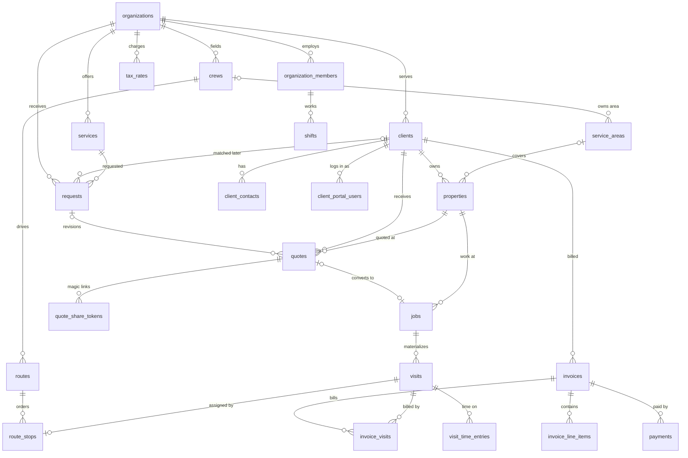
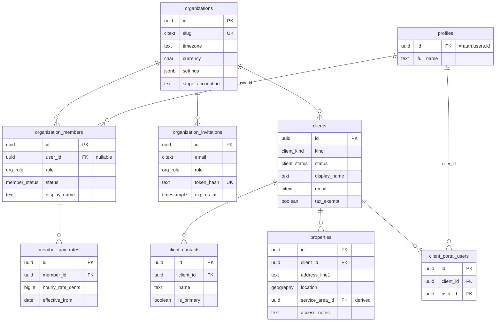
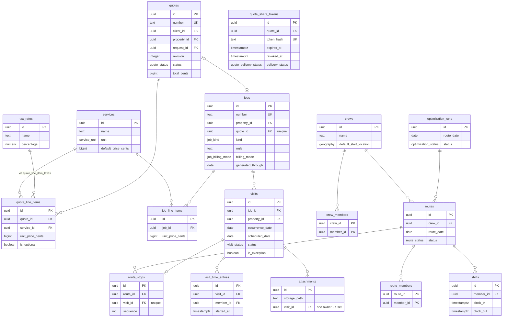
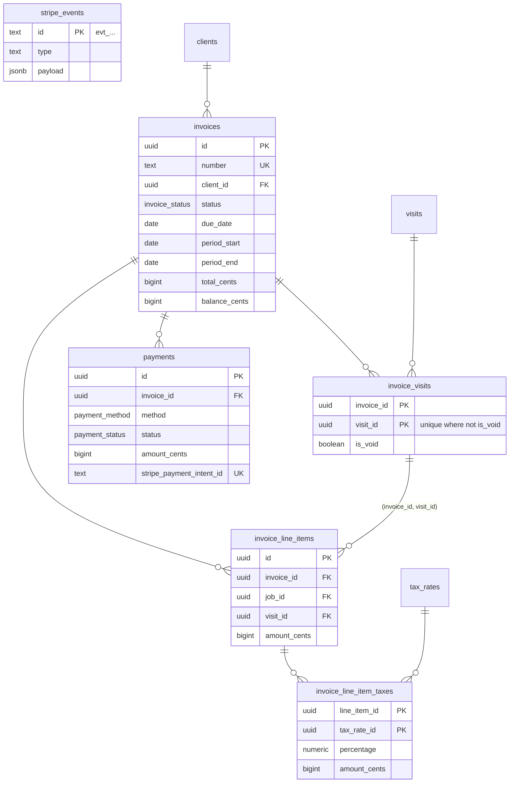
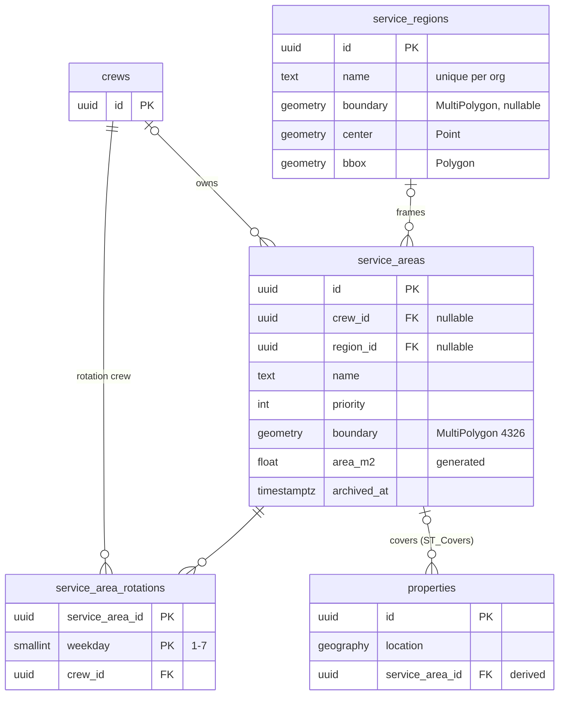

# Entity-relationship diagrams

These diagrams show relationships and the key columns only. Full column
lists live in [tables/](tables/). Every tenant table also carries
`organization_id` (omitted below) and references its parents through
composite `(organization_id, *_id)` foreign keys.

## Overview

## Tenancy, people & clients

## Work: catalog, quotes, jobs, visits, routing, time

## Money: invoices & payments

## Service areas

