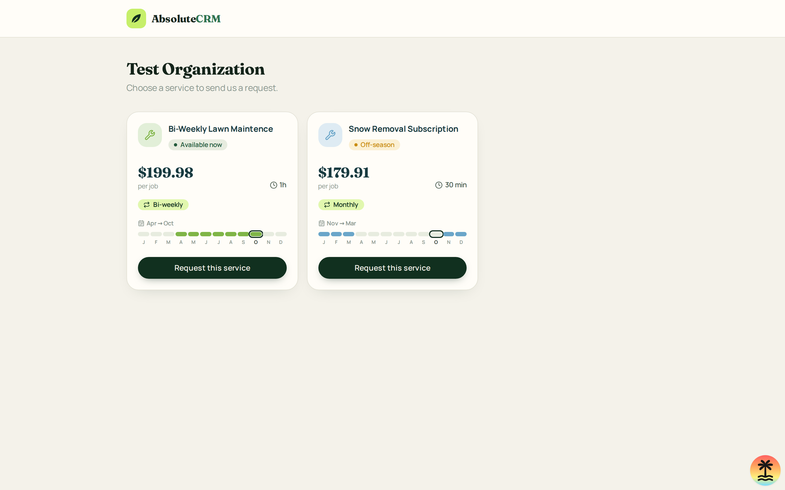
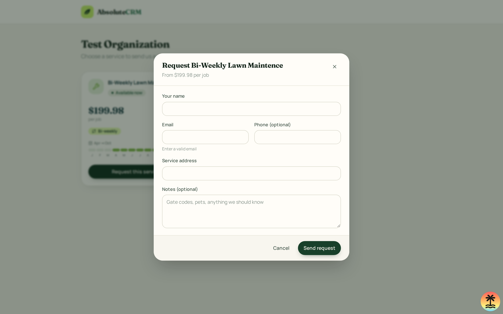
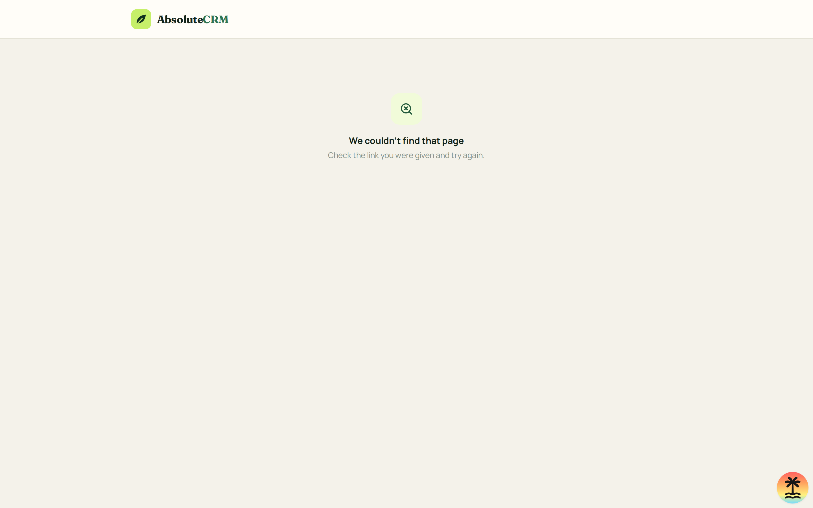

See the [design record README](../design/README.md) for the visual system and
screen-spec conventions.

| Screen         | Route               | What it shows                                                    |
| -------------- | ------------------- | ---------------------------------------------------------------- |
| Request portal | `/portal/$orgSlug`  | A business's services; a modal to send a request for one of them |
| Requests       | `/_authed/requests` | Organization requests, filters, and read-only details            |

## Internal Requests

**Route**: `/_authed/requests`. Requires an authenticated user with the
`manageRequests` permission in the active organization.

**Layout**: The existing request pipeline counts, search field, and status
filters are retained. The table shows the customer's name and address, service,
submission date and relative time, source, and status. Selecting a row opens a
read-only details drawer with contact information, address, service, notes,
source, submission time, and status. There are no create, quote, schedule,
convert, or status-change actions.

**States**:

- Organization context loading: "Loading organization…".
- Organization context error: an error message and a page-reload action.
- No active organization: "No active organization".
- Requests or services loading: "Loading requests…".
- Query error: an error message and a retry action.
- No requests: "No requests yet".
- Search or status filter has no matches: "No matching requests".
- Populated: organization-scoped requests ordered by submission time.
- Users without `manageRequests`: the standard no-access state; neither query
  is enabled.

**Data**: `requests.list` and `services.list`, both queried with the active
organization ID. The server continues to verify membership, permission, RLS,
and organization scoping. Service names are joined for display; a missing
service is shown as "Service unavailable".

**Interactions**: Search matches customer name, address, and service name.
Pipeline stages and Open / Rejected / All filters retain their counts.
Selecting a row opens its details; closing the drawer returns to the list.
Changing organizations remounts the panel, clears its local filters and
selection, and loads the new organization's results.

**Origin**: Replaces the previous demo-request list and workflow drawer with
read-only live data. Request creation and status changes remain deferred.

**Code**: [`src/routes/_authed/requests.tsx`](../../src/routes/_authed/requests.tsx),
[`src/components/requests/RequestsPanel.tsx`](../../src/components/requests/RequestsPanel.tsx),
[`src/integrations/requests/requests.ts`](../../src/integrations/requests/requests.ts).

## Request portal

**Route**: `/portal/$orgSlug`. Public, outside `_authed`, with no app chrome.

**Roles**: Anyone with the link. No sign-in. Staff see the submitted request on
the internal Requests page (owner, admin and dispatcher; not workers).

**Layout**: A header with the logo, the organization name and a prompt, then a
responsive grid (1, 2, 3 columns) of cards that match the internal Services
page: a colored icon tile, an "Available now" or "Off-season" badge, price and
unit, duration, frequency badges, the season label with the 12-month season
bar, and a full-width "Request this service" button. Internal fields such as
equipment are never shown.

**States**:

- Loading: "Loading…".
- Unknown organization: "We couldn't find that page".
- Other error: "Something went wrong", reload hint.
- No services: "No services available yet".
- Populated: cards as above. Off-season services can still be requested.

**Interactions**:

- "Request this service" opens a modal titled with the service name and price.
- The modal asks for name, email, phone (optional), service address and notes
  (optional). The service defines its own frequencies, so visitors are not
  asked for one.
- Send validates name, email and address, then submits. Errors from the server
  (rate limit, service no longer available) show inside the modal.
- Success replaces the form with a confirmation naming the service and email.
- A hidden "Website" field is a honeypot; filled values are rejected.

**Data**: `portal.get` (public) and `portal.submit` (public, rate limited to 5
per IP and 50 per organization per hour). Both run through the trusted
service-role helpers; see [requests tables](../database/tables/requests.md).

**Origin**: Built without a mock, reusing the Services page card styling.

**Code**: [`src/routes/portal/$orgSlug.tsx`](../../src/routes/portal/$orgSlug.tsx),
[`src/components/portal/RequestModal.tsx`](../../src/components/portal/RequestModal.tsx),
[`src/server/trusted/portal.ts`](../../src/server/trusted/portal.ts).
